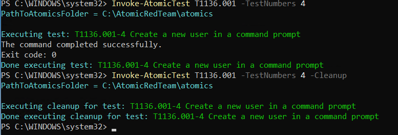
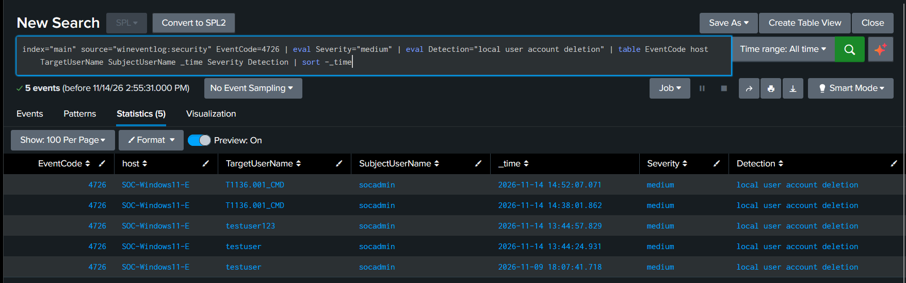
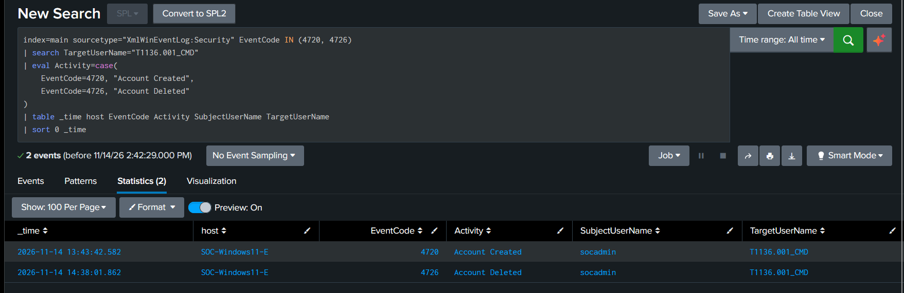

# Detection 02 — Local Account Creation

## 1. Objective

Detect the creation of new local Windows user accounts and identify the account responsible for creating them.

Unexpected account creation may indicate an attacker establishing persistence or creating additional accounts for unauthorised access.

## 2. Detection Information

| Attribute | Value |
|---|---|
| Detection Name | Local Account Creation |
| Platform | Windows 11 |
| Log Source | Windows Security Event Log |
| Event ID | 4720 |
| Detection Technology | Splunk Enterprise |
| Severity | Medium (initial triage classification) |
| MITRE ATT&CK | T1136.001 — Create Local Account |

## 3. Relevant Windows Event

**Event ID 4720 — A user account was created.**

Important fields:

- `SubjectUserName`: Account that performed the creation.
- `SubjectDomainName`: Domain of the initiating account.
- `TargetUserName`: Newly created account.
- `TargetDomainName`: Domain of the new account.
- `TargetSid`: Security identifier of the new account.
- `SubjectLogonId`: Logon session associated with the action.

## 4. Splunk Detection Query

```spl
index=main sourcetype="XmlWinEventLog:Security" EventCode=4720
| eval Severity="Medium"
| eval Detection="Local User Account Created"
| table _time host Severity Detection SubjectUserName TargetUserName TargetDomainName
| sort -_time
```

This search identifies Windows account-creation events and displays the initiating account and newly created account.

## 5. Lab Validation

### Test Environment

- Windows 11 endpoint VM
- Splunk Enterprise SIEM
- Splunk Universal Forwarder
- Sysmon and Windows Security event collection
- Atomic Red Team

### Attack Simulation

**MITRE ATT&CK Technique:** T1136.001 — Create Local Account

**Atomic Test:** T1136.001-4 — Create a new user in a command prompt

The test created a local account named `T1136.001_CMD` using the Windows `net user` command.

### Validation Results

1. Executed the Atomic Red Team test with administrative privileges.
2. Verified that the test account was created.
3. Confirmed Windows Security Event ID 4720 was generated.
4. Confirmed that Splunk received the event.
5. Identified the administrator account as the initiating account.
6. Confirmed that the detection search displayed the relevant event and fields.
7. Executed the Atomic Red Team cleanup.
8. Verified that Event ID 4726 (account deletion) reached Splunk.
9. Correlated the account creation and deletion events using the username and timeline.

**Result:** Initial detection validation successful.

## 6. Event Correlation Query

The following search correlates account creation and deletion events for the test account.

```spl
index=main sourcetype="XmlWinEventLog:Security" EventCode IN (4720, 4726)
| search TargetUserName="T1136.001_CMD"
| eval Activity=case(
    EventCode=4720, "Account Created",
    EventCode=4726, "Account Deleted"
)
| table _time host EventCode Activity SubjectUserName TargetUserName
| sort 0 _time
```

## 7. SOC Investigation and Analysis

An account creation event is not automatically malicious.

During an investigation, an analyst should:

- Identify the account that created the new user.
- Verify whether the activity was authorised.
- Check whether the new account was added to privileged groups.
- Investigate subsequent logon activity involving the new account.
- Correlate account creation with other security events.
- Check whether the account was deleted shortly after creation.
- Review the activity against change-management records and maintenance windows.

## 8. Limitations and False Positives

- Legitimate administrators regularly create user accounts.
- Event ID 4720 alone does not establish malicious activity.
- The detection requires investigation and contextual correlation.
- The lab simulation was performed locally and does not represent an external attack.
- Severity should be adjusted according to organisational context and investigation findings.

## 9. MITRE ATT&CK Mapping

| Technique | ID | Description |
|---|---|---|
| Create Account | T1136 | Adversaries may create accounts to maintain access |
| Create Local Account | T1136.001 | Adversaries may create local accounts on compromised systems |

## 10. Evidence

1. Atomic Red Team test execution:


2. Splunk detection results:


3. Correlated creation and deletion timeline:


---

**Detection Status:** Initial validation completed

**Project:** Home SOC Lab — Security Monitoring and Detection with Splunk Enterprise