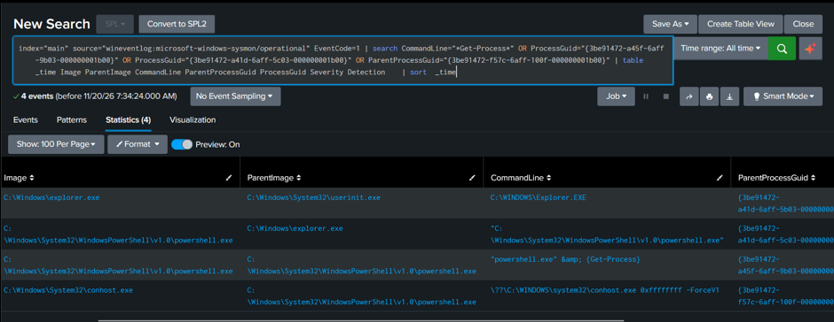
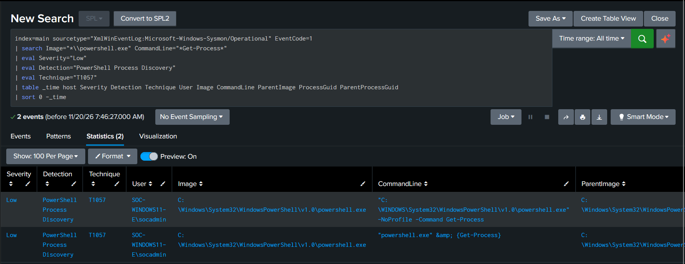

# Detection 04 — Process Discovery Using PowerShell

## Overview

| Attribute | Details |
|---|---|
| Detection Name | PowerShell Process Discovery |
| MITRE ATT&CK | T1057 — Process Discovery |
| Log Source | Windows Sysmon |
| Event ID | 1 — Process Create |
| Detection Severity | Low |
| Tool | Splunk Enterprise |
| Validation Tool | Atomic Red Team |

## Objective

Detect PowerShell execution involving the `Get-Process` cmdlet, which can be used to enumerate running processes on a Windows endpoint.

Process discovery is a legitimate administrative activity but can also be performed by attackers to understand the running environment after gaining access to a system.

## Data Source

Windows Sysmon Operational logs collected through Splunk Universal Forwarder.

Relevant fields:

- `Image`
- `CommandLine`
- `User`
- `ParentImage`
- `ParentCommandLine`
- `ProcessGuid`
- `ParentProcessGuid`

## Detection Logic

The detection identifies PowerShell process creation events whose command line contains `Get-Process`.

### SPL Query

```spl
index=main sourcetype="XmlWinEventLog:Microsoft-Windows-Sysmon/Operational" EventCode=1
| search Image="*\\powershell.exe" CommandLine="*Get-Process*"
| eval Severity="Low"
| eval Detection="PowerShell Process Discovery"
| eval Technique="T1057"
| table _time host Severity Detection Technique User Image CommandLine ParentImage ProcessGuid ParentProcessGuid
| sort 0 -_time
```

## MITRE ATT&CK Mapping

**T1057 — Process Discovery**

Attackers may enumerate running processes to understand the environment, identify security tools, and discover potentially valuable applications or services.

## Atomic Red Team Validation

### Test Details

| Attribute | Value |
|---|---|
| Technique | T1057 |
| Atomic Test Number | 3 |
| Test Name | Process Discovery — Get-Process |
| Test GUID | `3b3809b6-a54b-4f5b-8aff-cb51f2e97b34` |
| Executor | PowerShell |
| Privileges Required | No |

### Test Command

```powershell
Get-Process
```

The Atomic Red Team test executed the PowerShell `Get-Process` cmdlet to enumerate running processes.

### Observed Evidence

Sysmon captured PowerShell process creation events.

The relevant event contained:

- Image: `powershell.exe`
- Command line containing `Get-Process`
- Parent process information
- Process GUID and Parent Process GUID

The focused SPL query successfully identified the event.

## False-Positive Assessment

A separate legitimate administrative command was executed:

```powershell
powershell.exe -NoProfile -Command "Get-Process"
```

The detection also identified this activity.

This confirmed that the detection matches legitimate process enumeration as well as the Atomic Red Team test.

### Analyst Assessment

The presence of `Get-Process` alone does not establish malicious activity.

An analyst should investigate:

- User account associated with execution
- Parent process and process execution chain
- Command-line arguments
- Endpoint context and role
- Other suspicious activity around the same time

## Detection Limitations

- The detection is specific to PowerShell command lines containing `Get-Process`.
- Other process discovery utilities and techniques are not covered.
- Sysmon Event ID 1 records process creation, not every command executed inside an existing PowerShell session.
- Legitimate administrative activity can trigger the detection.
- A matching event is an investigation lead, not proof of compromise.

## Validation Summary

| Validation | Result |
|---|---|
| Atomic Red Team T1057 Test 3 | Passed |
| Sysmon Event ID 1 collection | Confirmed |
| PowerShell command-line visibility | Confirmed |
| Focused SPL detection | Passed |
| Legitimate activity test | Detected |
| False-positive assessment | Completed |

## Evidence

1. Get-Process parent-child event:



2. Detection rule for suspicious get-process command:


3. False Positive by Detection Rule:




## Conclusion

Successfully implemented and validated a PowerShell-based process discovery detection using Splunk Enterprise and Sysmon.

The lab demonstrated how process enumeration can be monitored and how legitimate administrative activity can generate the same detection signals as controlled attack simulations.

Further improvements could include broader process-discovery coverage, contextual correlation, and detection tuning.