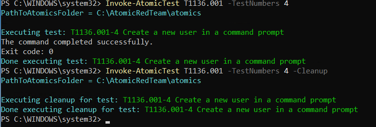

# Detection 01 — Repeated Failed Logon Attempts

## Objective
Identify repeated failed Windows authentication attempts that may indicate password guessing or brute-force activity.

## Data Source
- Platform: Windows 11
- SIEM: Splunk Enterprise
- Log source: Windows Security
- Sourcetype: `XmlWinEventLog:Security`
- Event ID: 4625

## Detection Logic
- Group events by source IP and target username.
- Use a five-minute time window.
- Trigger when three or more failed logons occur within the window.

## SPL Query

```spl
index=main sourcetype="XmlWinEventLog:Security" EventCode=4625 earliest=-15m
| bin _time span=5m
| stats count as FailedAttempts
    values(Status) as Status
    values(SubStatus) as SubStatus
    values(LogonType) as LogonTypes
    values(AuthenticationPackageName) as AuthPackages
    by _time IpAddress TargetUserName
| where FailedAttempts >= 3
| sort -FailedAttempts
```

## Lab Validation

- Test account: `soc_testuser`
- Failed authentication events observed: 3
- Source address: `::1` (IPv6 loopback)
- Logon type: 3 (Network)
- SubStatus: `0xc000006a` (Incorrect password)
- Detection result: Successfully identified the activity.

## MITRE ATT&CK
- Tactic: Credential Access
- Technique: T1110 — Brute Force
- Relevant sub-technique: T1110.001 — Password Guessing

## Limitations
- Three failures in five minutes is a lab threshold, not a production recommendation.
- Failed logons alone do not establish malicious activity.
- Successful authentication events should be correlated during investigation.
- Loopback traffic in this test does not represent an external attack.

## Evidence

