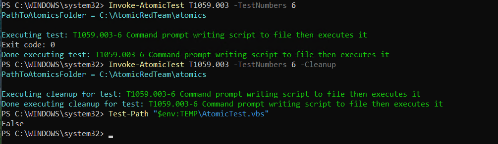
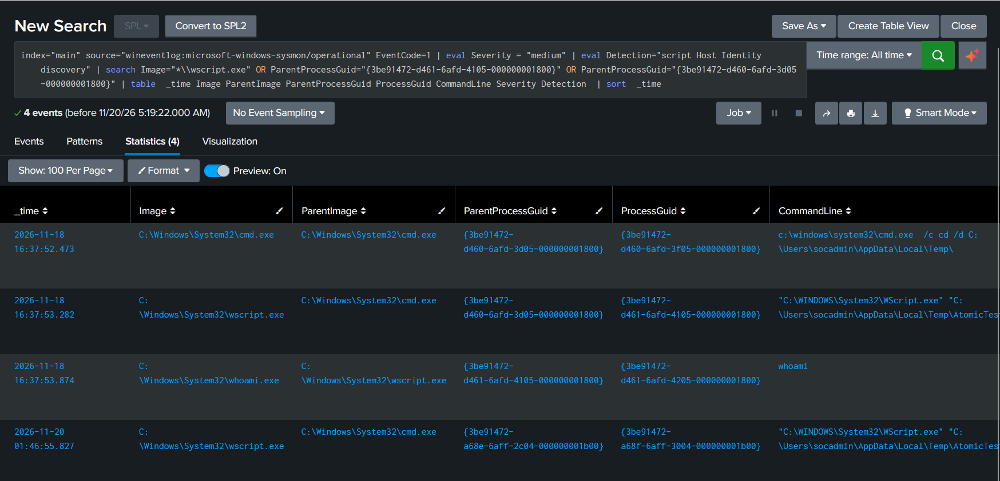

# Detection 03 — Suspicious Script Host Execution and Identity Discovery

## 1. Overview

**Detection Name:** Script Host Executing Identity Discovery Command  
**Platform:** Windows 11  
**SIEM:** Splunk Enterprise  
**Log Source:** Sysmon Operational  
**Event ID:** 1 — Process Creation  
**Severity:** Medium (Lab Classification)  
**Status:** Successfully Validated

### Objective

Detect instances where Windows Script Host (`wscript.exe`) launches `whoami.exe`.

This behavior may indicate script-based command execution and user or security-context discovery on a Windows endpoint.

## 2. Security Relevance

Attackers may use Windows scripting engines to execute commands indirectly and gather information about the compromised system.

The `whoami.exe` utility reveals the identity and security context under which a process is running.

Monitoring the parent-child process relationship can help identify suspicious script execution patterns.

## 3. MITRE ATT&CK Mapping

| Technique | ID | Description |
|---|---|---|
| Command and Scripting Interpreter: Windows Command Shell | T1059.003 | Windows command shell execution |
| Command and Scripting Interpreter: Visual Basic | T1059.005 | Visual Basic script execution |
| System Owner/User Discovery | T1033 | Discover the current user or security context |

## 4. Data Sources and Required Fields

**Sysmon Event ID 1 — Process Creation**

The following fields were used:

| Field | Purpose |
|---|---|
| Image | Executable path of the current process |
| CommandLine | Command used to launch the process |
| ParentImage | Executable path of the parent process |
| ParentCommandLine | Parent process command line |
| User | Security context of the process |
| ProcessGuid | Unique identifier of the current process |
| ParentProcessGuid | Unique identifier of the parent process |

Custom field extractions were configured in Splunk to make the required Sysmon fields searchable.

## 5. Detection Logic

The detection identifies `whoami.exe` executions where the parent process is `wscript.exe`.

**Splunk SPL Query:**

```spl
index=main sourcetype="XmlWinEventLog:Microsoft-Windows-Sysmon/Operational" EventCode=1 earliest=-24h
| search Image="*\\whoami.exe" ParentImage="*\\wscript.exe"
| eval Severity="Medium"
| eval Detection="Script Host Identity Discovery"
| table _time host Severity Detection User Image CommandLine ParentImage ParentCommandLine ProcessGuid ParentProcessGuid
| sort 0 -_time
```

### Detection Explanation

- Searches Sysmon process-creation events.
- Filters for `whoami.exe`.
- Checks whether its parent executable is `wscript.exe`.
- Assigns a lab severity classification.
- Displays process details and GUIDs for investigation.

## 6. Lab Simulation and Validation

**Testing Framework:** Atomic Red Team

**Technique Tested:** T1059.003 — Windows Command Shell

**Atomic Test Number:** 6

**Test Name:** Command prompt writing script to file then executes it

### Simulated Activity

1. Executed `cmd.exe`.
2. Created a VBScript file named `AtomicTest.vbs`.
3. Executed the script using Windows Script Host (`wscript.exe`).
4. The VBScript invoked `whoami.exe` through `WScript.Shell`.
5. The command returned the current security identity.

### Observed Process Execution Chain

```text
cmd.exe
   |
   └── wscript.exe
           |
           └── whoami.exe
```

The process relationships were verified using:

- `ProcessGuid`
- `ParentProcessGuid`

The GUID values confirmed the parent-child relationships between the three processes.

## 7. Validation Results

| Validation Item | Result |
|---|---|
| Sysmon Event ID 1 collected | Passed |
| cmd.exe process captured | Passed |
| wscript.exe process captured | Passed |
| whoami.exe process captured | Passed |
| Parent-child relationship verified | Passed |
| SPL detection returned expected event | Passed |
| Atomic test cleanup completed | Passed |

**Final Result:** The detection successfully identified the simulated script-host execution and identity-discovery activity in the lab environment.

## 8. Investigation Recommendations

When this detection triggers in a production environment, an analyst should:

1. Identify the user and endpoint associated with the event.
2. Inspect the command line and script file involved.
3. Investigate the parent process that launched Windows Script Host.
4. Review surrounding process-creation events.
5. Check for unusual script files, persistence mechanisms and suspicious network connections.
6. Correlate with other endpoint and security events before determining whether the activity is malicious.

## 9. Limitations and False Positives

- Legitimate administrative scripts may execute `whoami.exe`.
- Windows Script Host is a legitimate Windows component.
- This detection identifies a specific process relationship, not all forms of malicious scripting.
- A single matching event does not establish compromise.
- Additional context, such as script contents, user behavior and surrounding activity, is required for accurate incident classification.

## 10. Evidence

Add sanitized screenshots showing:

1. Atomic Red Team test execution:


2. Final Splunk detection results:


**Project:** Home SOC Lab — Security Monitoring and Detection with Splunk Enterprise.
